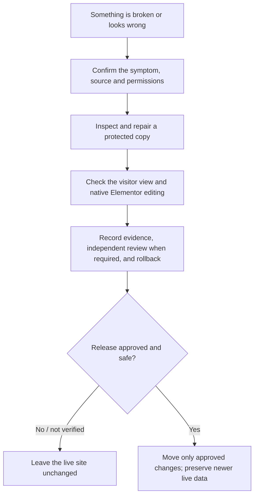

# WordPress & Elementor Rescue

**Fix the website problem without losing what is already working.**

A missing icon, an Elementor change that visitors cannot see, or a staging update that might overwrite new customer orders: small website fixes can carry much bigger risks.

**WordPress & Elementor Rescue** is a free, open-source **AI workflow skill for Codex and Claude**, created by **Roberta Nicholls at Mela Gaming & AI**. It gives your AI assistant a structured approach to finding the cause, working in a protected copy, making a focused repair and checking what visitors actually see.

**New to AI skills?** Think of a skill as a set of instructions and checklists for your AI assistant. This is **not** a WordPress plugin, one-click repair service or hosting connection. Your assistant still needs the right tools, site access and approval to make changes.

**Project edition:** v0.1.0 · MIT licensed · [Change history](CHANGELOG.md)

## Get started

### Using Codex

1. [Open the Codex skill folder](skills/repair-wordpress-elementor/) and download or copy the **complete folder**, including its `references/` and `agents/` subfolders, into your project's `.agents/skills/` directory.
2. In Codex CLI or the Codex IDE, invoke **`$repair-wordpress-elementor`** and describe the website problem.
3. Give it the affected page, what should happen, what actually happens and any site/source access you are authorised to provide.

[Browse Codex instructions](skills/repair-wordpress-elementor/SKILL.md) · [Official Codex skills guide](https://developers.openai.com/codex/skills/)

### Using Claude or Claude Code

- **Claude with custom skill uploads:** [Download the Claude skill ZIP](https://raw.githubusercontent.com/Iktar-ai/wordpress-elementor-rescue/main/dist/repair-wordpress-elementor-claude.zip). In **Customize → Skills**, upload the ZIP as supplied and enable it. Custom skills depend on your account/workspace allowing uploads and code execution.
- **Claude Code:** Download that ZIP, unzip it and place the complete `repair-wordpress-elementor/` folder inside your project's `.claude/skills/` directory (or `~/.claude/skills/` for personal use). Then invoke **`/repair-wordpress-elementor`** in that project.

[Browse Claude instructions](claude/skills/repair-wordpress-elementor/SKILL.md) · [Official Claude upload guide](https://support.claude.com/en/articles/12512198-how-to-create-custom-skills) · [Claude Code skill locations](https://code.claude.com/docs/en/skills#where-skills-live)

**Choose the edition for the assistant you use.** The download contains instructions and reference guides, not a paid plugin or hosting service. Codex, Claude, your hosting provider and any commercial Elementor licences remain separate.

## Three situations to try

| If this happens | Ask your assistant |
| --- | --- |
| **You updated a page, but visitors still see the old version.** | “Elementor shows our event at 18:00, but the public page still says 17:00. Please identify the page, template or cached version visitors receive and tell me how to verify the fix outside the editor.” |
| **You moved the site and icons or fonts disappeared.** | “An icon disappeared after our website moved. Trace the missing asset to its file, URL or dependency, then check the repaired page on desktop and mobile in our private preview.” |
| **Your staging fix is ready, but live orders kept arriving.** | “We changed the layout in staging, and the live store has newer orders. Determine whether only the changed files need to move. If data must move, identify what to reconcile and the rollback before proposing a release.” |

These are *illustrative requests*, not claims that the skill has repaired three live client sites. See the [field guide](skills/repair-wordpress-elementor/references/field-guide.md), [delivery examples](skills/repair-wordpress-elementor/references/delivery-examples.md) and [Hostinger-specific guide](skills/repair-wordpress-elementor/references/hostinger.md) for more detail.

## Who it is for

- **Website owners:** Understand the problem and what evidence to ask for before approving a fix or a live-site update.
- **Agencies and freelancers:** Diagnose inherited WordPress/Elementor sites while protecting client content, commerce and editability.
- **Developers and AI-assisted teams:** Use a repeatable process for staging, source inspection, focused changes, browser checks, review and rollback.

With **only a public URL or screenshots**, the skill can guide an assessment; it cannot reconstruct missing private source, licensed plugins or database records.

## How the workflow works

This is a **guided workflow**, not an automatic production deployment. It is designed to encourage a small, reversible change with evidence, rather than an untested “push everything live.”

## What to prepare before a repair

Share the affected URL or route, expected versus observed behaviour, and authorised access to the relevant source and **protected** preview. For a migration or any overwrite, confirm the coverage and recovery path for **both files and database**. Keep payments, email, subscriptions, webhooks and other live integrations isolated during preview testing.

Ask your assistant to return:
- The likely cause and the specific change it proposes.
- The changed source and a comparison of what visitors actually see.
- Native Elementor editing/save results, plus relevant desktop/mobile and browser checks.
- Backup and rollback details, open risks, and a clear **PASS / FAIL / NOT RUN / BLOCKED** status for each important check.

Do **not** post credentials, private backups, customer orders or client exports in public GitHub issues. The skill does not grant site permissions, guarantee restoration or bypass provider restrictions. A production release always needs the appropriate human decision.

## Testing, review and limitations

The **original Codex workflow** was exercised against **six synthetic decision scenarios**, including a scenario with newer orders on the live store. Those scenarios test the assistant's decisions and reporting; they **do not** demonstrate six successful live website rescues or certify compatibility with every host.

The original source also underwent independent Claude Code review of its workflow logic. A real client's repair still requires its own source checks, backup verification, protected-preview/browser tests, appropriate review and release approval. The Codex workflow calls for independent exact-version Claude Code review of material changes.

[Read the validation record and limits](skills/repair-wordpress-elementor/references/validation.md). Repository packaging and link checks are defined in [the verification script](scripts/check_package.py); those checks do not replace live WordPress testing.

## Contribute or report a problem

For a documentation or workflow issue, provide the edition, revision, symptom, a **sanitised** reproduction, expected outcome and evidence of how to test it. Keep private client information and passwords out of public issues. For security-sensitive findings, use private vulnerability reporting if available, or an established private channel with the maintainer.

## Related work

- [WordPress Agent Skills](https://github.com/WordPress/agent-skills) — broader WordPress development and operations.
- [Respira's Elementor-to-Gutenberg skill](https://github.com/respira-press/agent-skills-wordpress/tree/main/skills/migrate-elementor-to-gutenberg) — editor conversion.
- [VibePress](https://github.com/MrCyber02/vibepress) — rebuilding sites in Elementor.

This project focuses on **repairing or recovering an existing site while keeping native WordPress/Elementor editing**.

## Licence and attribution

Copyright © 2026 **Roberta Nicholls**. Original files in this repository are available under the [MIT licence](LICENSE). Third-party WordPress core, themes, plugins, fonts, media and client assets retain their own licences.
